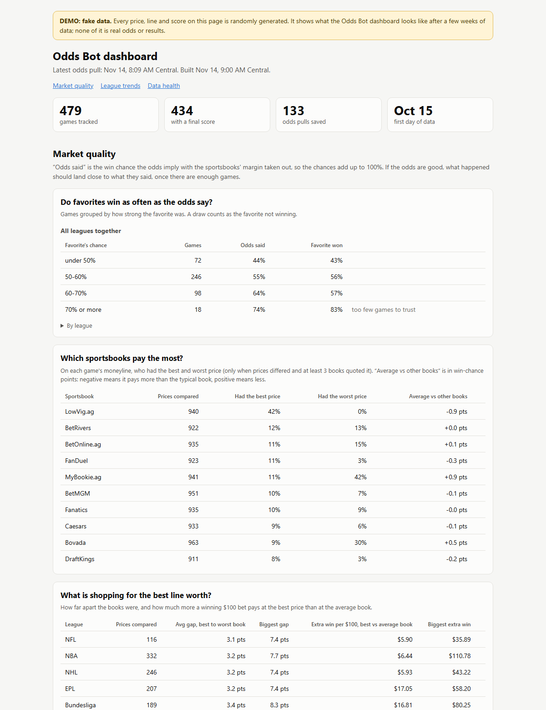
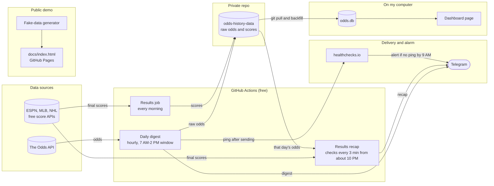

# Daily Sports Odds Digest (Telegram Bot)

[](https://github.com/Vic-Analytics/odds-bot/actions/workflows/tests.yml)

A Python bot that sends a formatted digest of **today's games and best available betting lines** to Telegram every morning, scheduled for 7:15 AM Central. It runs in the cloud on GitHub Actions, so no computer needs to stay on.

> For information only. This project does not place bets or give betting advice.

## What it looks like

One message per sport. Each game shows the best line across US sportsbooks and the book offering it, with a small emoji beside each team:

```
🏒 NHL — Sat, Oct 17

8:10 PM · Pittsburgh Penguins @ Colorado Avalanche
┃ Moneyline
┃ 🐧 Pittsburgh Penguins  +150  (DraftKings)
┃ 🏔️ Colorado Avalanche  -170  (FanDuel)
┃
┃ Total goals
┃ ⬆️ Over 6.5  -112  (BetRivers)
┃ ⬇️ Under 6.5  -103  (BetOnline.ag)
```

Soccer also shows the over/under on goals, and clubs get kit-color dots:

```
⚽ EPL — Sat, Oct 17

8:00 AM · Bournemouth vs Sunderland
🔴 LIVE · Bournemouth 1–0 Sunderland
┃ Moneyline (live odds)
┃ 🔴⚫ Bournemouth  -150  (FanDuel)
┃ 🤝🤝 Draw  +340  (Bovada)
┃ 🔴⚪ Sunderland  +500  (Bovada)
┃
┃ Total goals (live odds)
┃ ⬆️ Over 2.5  -112  (Bovada)
┃ ⬇️ Under 2.5  -108  (Bovada)
```

*(Illustrative numbers. Real messages use bold headlines and Telegram quote blocks, which is what the vertical bar represents here.)*

## Dashboard demo



**[Open the live demo](https://vic-analytics.github.io/odds-bot/)**: the analysis dashboard (see "Analysis") built from **synthetic data**. The league and team names are real, but every price, line and score is randomly generated. The page is marked "DEMO: fake data" and never contains my real odds history, which stays in a private repo.

- **How the fake data is made:** `analysis/demo_data.py` gives every team a hidden strength, prices each game at 6 to 10 sportsbooks (each with its own margin and its own small disagreements, and the occasional stale price), prices every game twice so the market "moves", and draws the scores from the same strengths. It uses its own tiny random number generator, so the same seed gives the same page on every computer.
- **Tests prove it is synthetic:** the generator imports nothing that can reach the network or the data folder, a test builds it with both blocked, every game id and source is marked as demo data, and the page must contain the banner. Another test fails if the committed `docs/index.html` is out of date.
- **Regenerate it:** `.\.venv\Scripts\python.exe scripts\make_demo.py` writes `docs/index.html`.
- **Published with GitHub Pages**, serving the `docs/` folder of the `main` branch.

## Features

- **Best line across all books.** For each game it finds the highest moneyline price per team. For spreads and totals it takes the most common line, then the best price at that number, so a rare odd alternate line can't look like a bargain.
- **Today only, in Central time.** The API returns UTC. Start times are converted with a named time zone (`America/Chicago`), so daylight saving is handled automatically.
- **15 leagues.** NFL, NBA, MLB, NHL, WNBA, UFC/MMA, EPL, Champions League, Europa League, Conference League, La Liga, Serie A, Bundesliga, Ligue 1 and MLS. Adding a league is one line in `config.py`.
- **Market per sport.** The NFL, NBA and WNBA show moneyline and point spread. MLB and the NHL show moneyline and total runs/goals. Soccer shows moneyline (with the draw) and total goals. MMA shows moneyline only.
- **Live game awareness.** A game that has already started when the digest runs is marked 🔴 LIVE with its current score, and its odds are labeled as live.
- **Team emoji.** NFL, NBA, NHL, MLB and WNBA teams get an emoji matched by nickname, so "LA Clippers" and "Los Angeles Clippers" both work. Soccer clubs get two kit-color dots (a one-color kit shows its dot twice, and the Draw row gets 🤝🤝) so every row lines up. UFC fighters get a country flag from a hand-kept list, because the API doesn't provide nationality.
- **Telegram-friendly output.** HTML formatting, one message per sport, and automatic splitting when a long slate would pass Telegram's 4096-character limit.
- **Results recap.** Right after the last game of the day finishes, one more message lists every finished game: the score, the favorite according to that morning's odds, and whether the favorite won, it was an upset, or it was a draw (see below).
- **Failure alerts.** If a sport fails, the others still send, and a short error message arrives on Telegram. The run also exits with an error code, so GitHub marks it failed.
- **Retries.** Timeouts, dropped connections and temporary server errors are retried up to 3 times. Client errors (a bad key) and exhausted API credits are not, because trying again can't help.
- **Tested.** Around 200 automated tests run on every push (see below).
- **Secrets stay secret.** Keys live in `.env` locally and in GitHub Secrets in the cloud. Error text is scrubbed of keys and tokens before it is shown anywhere, because Python network errors can include the full request URL.

## Built to stay inside a free API tier

The Odds API's free tier gives 500 credits a month, and each market in each request costs 1 credit. Calling every sport daily would cost about 15 credits a day. The bot avoids that:

1. It first calls the API's **free** events endpoint to see whether a sport has any game today.
2. It only spends credits on sports that do, with one request per sport and never in a loop.
3. Sports use only the markets they need. MMA has no point spread, so it requests moneyline only (1 credit, not 2).
4. If a game has already started, it spends 1 extra credit on that sport to fetch the live score. This only happens when a game is underway at digest time.
5. It reads the remaining quota from the response headers. It warns you when credits run low and refuses a call it can't afford.

A busy month with all 15 leagues comes to roughly 315 credits by my estimate.

## How it works

The whole system at a glance:



The daily digest in more detail:

```
GitHub Actions (cron: every hour at :15, 12:15-19:15 UTC)
        │
        ▼
   gate.py  ── inside the 7 AM-2 PM Central window? already sent today? (else stop)
        │
        ▼
   main.py  ── fetch, format, send, and leave a "sent today" marker
        │
        ├─ games_today.py ── free events check → filter to today (Central)
        │        └─ odds_api.py ── paid odds request, only if games exist
        │                          (+ scores request if a game is already live)
        ├─ format_digest.py ── best lines → Telegram HTML messages
        │        └─ team_emoji.py ── emoji per team
        │                 ├─ soccer_emoji.py ── kit colors
        │                 └─ ufc_flags.py ── fighter flags
        └─ telegram_bot.py ── sendMessage via the Telegram Bot API
```

### Why it runs every hour

GitHub's cron runs on UTC, which doesn't follow daylight saving, and GitHub starts scheduled runs **late**: often 30 to 50 minutes, and sometimes hours. My first version ran twice a day and only sent if the clock said exactly 8 AM Central. One day GitHub started both runs over an hour late, both correctly decided it was too late, and no digest was sent.

The fix is to stop depending on one moment:

1. The workflow starts every hour at 15 minutes past, from 12:15 to 19:15 UTC. That covers 7:15 AM to 2 PM Central in both summer and winter. GitHub is busiest at the top of the hour and recommends avoiding :00, so the schedule uses :15.
2. `gate.py` lets a run through only if it is inside that window. The first run inside it sends the digest.
3. `main.py` then writes a small marker, which the workflow saves in GitHub's cache under today's date. Later runs find the marker and do nothing, so you get one digest a day.
4. If a run is late or fails completely, the next hour's run covers it. A concurrency lock stops two runs from sending at once.

The tests simulate GitHub starting every run up to four hours late, in both seasons and on the days daylight saving starts and ends, and check that a run always lands inside the window.

### Missed-digest alarm

If no digest arrives, I want to hear about it from something that does not depend on the thing that broke. So right after the digest is delivered, a workflow step pings [healthchecks.io](https://healthchecks.io), a free heartbeat service. If its daily ping has not arrived by the deadline (9:00 AM Central), **it** sends me an alert.

- **Why outside GitHub:** a second GitHub workflow would share GitHub's failure modes. If GitHub is down, the schedule is switched off (GitHub does that after 60 days without repository activity) or the Telegram token is revoked, such a check goes silent too. healthchecks.io alerts through its own channel in all of those cases.
- **It cannot hurt the digest:** the ping runs after the digest is sent, tries at most 3 times for 10 seconds each, can never fail the run, and does nothing if the secret is missing (`scripts/ping_healthcheck.py`). The service only receives "a ping happened at this time", no data.
- **One-time setup** (about 10 minutes, all in a browser):
  1. Sign up at healthchecks.io (free).
  2. Create a check. Set the schedule to the cron expression `0 7 * * *`, the time zone to `America/Chicago`, and the grace time to 2 hours. It then alerts at 9:00 AM Central and follows daylight saving by itself. To move the deadline, change the grace time (see "Choosing the deadline" below).
  3. Under **Integrations**, add **Telegram** and press Start in the bot it opens. Alerts will come from that bot, not from the odds bot.
  4. Copy the check's **ping URL** (it looks like `https://hc-ping.com/…`).
  5. In this repo go to Settings, Secrets and variables, Actions, New repository secret. Name it `HEALTHCHECK_PING_URL` and paste the URL. Treat it like a password: anyone with it can send a fake ping.
  6. Test it: Actions, Daily odds digest, Run workflow. The check on healthchecks.io should turn green within a minute. (A manual run sends a real digest and uses credits, like any manual run.)
- **A late digest still counts if it lands before the deadline.** One that arrives after it triggers an alert; the digest is still sent when it runs.
- **Choosing the deadline:** the alert should come soon after the digest was due, but not so soon that a late run triggers a false alarm. Since the hourly schedule was added (Oct 27), the digest has started sending between 7:00 and 7:30 AM Central in winter and around 8:10 AM in summer (the send window opens at 7 AM Central, and GitHub starts runs late). 9:00 AM leaves a margin in both seasons. 8:30 AM is tighter: it works in winter but would have been only about 20 minutes after a normal summer digest. healthchecks.io has one fixed time, so it cannot follow the seasons; change the grace time (1 hour is 8:00 AM, 1.5 hours is 8:30 AM) if you prefer a different trade-off.

### Results recap

When the last game of the day has finished, a second message arrives: one section per league with each finished game's score, the favorite according to that morning's consensus odds, and **Favorite won**, **Upset** or **Draw**. Soccer odds are for the first 90 minutes, so a soccer game that went to extra time counts as a draw. A busy day (a full Saturday) is split into 2 or 3 messages to stay under Telegram's length limit.

```
🏒 NHL
🐧 Pittsburgh Penguins 2 – 4 🏔️ Colorado Avalanche
Favorite: 🏔️ Colorado Avalanche 61% · ✅ Favorite won
```

- **How it knows the last game is over:** nothing announces it, so a run of `recap.yml` stays alive and checks the free score sources (ESPN, MLB, NHL) every 3 minutes until the last game is final, then sends the recap and leaves a marker so it is sent once. **Smart start:** no game is final sooner than 90 minutes after it starts, so each night the recap works out the earliest the last game could end (the latest game start plus 90 minutes: 10:40 PM on most nights) and does not ask for scores before that. A run that starts hours too early exits after about a minute, and one that starts within 30 minutes of that time stays and waits. It costs no Odds API credits.
- **A day is 10 AM to 10 AM:** a game that starts at 9 PM and ends at 12:30 AM still belongs to the day it started on (`recap_gate.py`).
- **A postponed game cannot hold it up:** a game with no final score 5 hours after its start is skipped. Games missing a score or odds are skipped quietly, and a day with no finished games sends nothing.
- **How close to "right after":** within a few minutes of the last final score. An earlier version woke up every 20 minutes and relied on GitHub's timer, but that timer is best effort: it really ran about once an hour, and on Nov 11 it started nothing for nine hours, so a recap that was minutes away arrived at 9 AM instead. Now the run that starts at the right time stays alive instead of depending on the timer again. The timer still starts a run every 30 minutes (every 10 minutes from about 9 PM to 2 AM, when it matters) to give GitHub many chances, and it is the safety net that sends a missed recap the next morning; an extra run that finds the "already sent" marker does nothing.
- **What it costs:** GitHub Actions time, which is free while this repository is public. Checking all evening would take about 6 hours a night (roughly 170 hours a month). Smart start takes about 1 to 2.5 hours a night (from about 10:10 PM until the last final) plus about a minute for each early run that exits, roughly 60 hours a month. A private repository gets 2,000 free minutes (about 33 hours) a month, which even this would exceed, so make it private only if you change this first. The risk of smart start is that the run that matters must be started by GitHub's timer: if it skips every attempt from about 10 PM to the finish, the recap arrives the next morning, and the missed-recap alarm below tells you.
- **The secrets are split:** one step uses the deploy key only to download the data, and the next uses the Telegram token only to send.
- **Try it safely on your computer** (nothing is sent, no credits are used; it needs a clone of the data repo, see "Analysis"):

  ```
  .\.venv\Scripts\python.exe recap.py --dry-run --data-dir ..\odds-history-data              today's recap, or "waiting: 3 of 12 games not final yet"
  .\.venv\Scripts\python.exe recap.py --dry-run --data-dir ..\odds-history-data --no-wait    what is final right now
  .\.venv\Scripts\python.exe recap.py --dry-run --data-dir ..\odds-history-data --date 2026-11-07
  ```

  Run these from the project folder with the project's own Python, as above. A plain `python` is your computer's general Python and does not have the libraries (the error is `No module named 'dotenv'`).

  In the cloud, Actions, Results recap, Run workflow sends a recap right away for whatever is final.

### Missed-recap alarm

The recap has its own heartbeat on healthchecks.io, set up the same way as the digest alarm above. Once the day's recap is done (sent, or the day had no games to report), the workflow pings a second check. If that ping has not arrived by **4:00 AM Central**, healthchecks.io sends an alert, so a night like Nov 11 (recap at 9 AM) tells you at 4 AM instead of leaving you wondering.

- **What counts as done:** the recap was sent, or the day finished with nothing to report. The ping runs after the recap went out and the marker was saved, tries at most 3 times for 10 seconds each, can never fail the run, and does nothing if the secret is missing (the same `scripts/ping_healthcheck.py`, told to read `HEALTHCHECK_RECAP_PING_URL`). A manual "Run workflow" run does not ping.
- **One-time setup** (about 5 minutes, in the same healthchecks.io account):
  1. Create a second check named `Results recap`.
  2. Set the schedule to the cron expression `0 17 * * *`, the time zone to `America/Chicago`, and the grace time to **11 hours**. It then alerts at 4:00 AM Central and follows daylight saving by itself.
  3. Turn on the same Telegram integration for it (the check's **Integrations** tab).
  4. Copy this check's own **ping URL**. It is a different URL from the digest check's.
  5. In this repo go to Settings, Secrets and variables, Actions, New repository secret. Name it `HEALTHCHECK_RECAP_PING_URL` and paste the URL. Treat it like a password.
  6. Test the wiring without waiting for tonight: open the ping URL once in your browser. The check turns green. After that the nightly recap keeps it green.
- **Why the cron time is 5 PM and not 4 AM:** healthchecks.io expects the next ping at the first cron time *after the last ping*. A recap ping at 12:30 AM with a 3 AM schedule would make it expect a second ping at 3 AM the same night and alert every night. The recap window opens at 6 PM, so no ping can arrive before 5 PM: after a ping the next expected time is 5 PM the next day, and the alert comes 11 hours later, at 4:00 AM.
- **Choosing the deadline:** the slowest legitimate night is one where a postponed game is waited on for 5 hours after its start (about 3:10 AM at the latest), so 4:00 AM gives a margin without false alarms. To change it, change the grace time (10 hours is 3:00 AM, 12 hours is 5:00 AM). A recap that arrives late (the 9 AM safety net) still pings, and the check turns green again.
- **Days with no games** also ping, shortly after midnight, so a quiet day does not raise a false alarm.

## Tech

- Python 3.12, `requests` (calls the Telegram Bot API and The Odds API directly, with no bot framework)
- `python-dotenv` for local configuration, `zoneinfo`/`tzdata` for time zones
- GitHub Actions for scheduling and hosting
- [The Odds API](https://the-odds-api.com) for odds and scores

## Project structure

| File | Purpose |
|---|---|
| `main.py` | Entry point: runs the whole digest and handles errors |
| `gate.py` | Decides whether a scheduled run is inside the send window |
| `config.py` | Sports list, sport emoji, markets per sport, MMA filter, credit warning level |
| `odds_api.py` | Odds API requests: events (free), odds, and live scores |
| `games_today.py` | Converts to Central time, keeps today's games, attaches live scores |
| `format_digest.py` | Best-line logic and message formatting |
| `team_emoji.py` | Emoji for NFL, NBA, NHL, MLB and WNBA teams (matched by nickname) |
| `soccer_emoji.py` | Kit-color dots for soccer clubs, with spelling aliases |
| `ufc_flags.py` | Country flags for UFC fighters (hand-kept list) |
| `check_emoji.py` | Free tool: lists teams in the schedule that have no emoji yet |
| `telegram_bot.py` | Sends messages to Telegram |
| `http_utils.py` | Web requests that retry on temporary failures |
| `storage.py` | Saves every odds response: raw JSON archive + SQLite database |
| `results.py` | Fetches final scores from free sources, saves them, and attaches them to games |
| `recap.py` | Sends the results recap once the day's last game has finished (`--dry-run` to preview) |
| `recap_gate.py` | Decides whether a recap run is inside the 6 PM to 10 AM window, and which day it is for |
| `central_time.py` | Central-time helpers (the day's UTC bounds, daylight saving included) |
| `names.py` | Decides whether two team names from different sources are the same team |
| `scripts/` | `make_demo.py` (build the fake-data demo page), `backfill_from_raw.py` (rebuild the database), `publish_data.py` (save raw files to the private data repo), `ping_healthcheck.py` (the missed-digest and missed-recap alarm pings) and `best_moneyline_today.py` (an example query) |
| `get_chat_id.py` | One-time helper to find your Telegram chat ID |
| `tests/` | Automated tests (fake data only, no network) |
| `.github/workflows/daily-odds.yml` | The schedule and cloud job |
| `.github/workflows/results.yml` | Daily job that saves final scores to the private data repo |
| `.github/workflows/recap.yml` | Starts in the evening, waits for the last game to be final (smart start) and sends the recap; pings the recap alarm |
| `.github/workflows/tests.yml` | Runs the tests on every push and pull request |
| `analysis/` | Read-only analysis tools: the dashboard, its calculations (`stats.py`), SQL, a loader, a starter notebook and the fake-data generator (`demo_data.py`) |
| `docs/` | The public demo page (`index.html`, built from fake data) and its screenshot |

## Run it locally

You need Python 3.10+, a Telegram bot token from [@BotFather](https://t.me/BotFather), your chat ID, and a free [Odds API](https://the-odds-api.com) key.

```powershell
git clone https://github.com/YOUR-USERNAME/YOUR-REPO.git
cd YOUR-REPO
python -m venv .venv
.\.venv\Scripts\Activate.ps1
pip install -r requirements.txt
Copy-Item .env.example .env      # then fill in your three values
```

```powershell
python get_chat_id.py            # after messaging your bot, to find your chat ID
python games_today.py            # free: lists today's games for every sport
python check_emoji.py            # free: which teams have no emoji yet
python main.py --dry-run         # prints the digest (uses API credits)
python main.py                   # sends the digest to Telegram
python results.py --files-only   # saves yesterday's final scores (free, no credits)
```

## Odds history

Every time the bot pulls odds from The Odds API, `storage.py` keeps a copy. It reads the response the bot already paid for, so it makes no extra API calls and costs no credits.

- **Raw archive:** the untouched response, saved as `data/raw/YYYY-MM-DD/<sport_key>__HHMMSSZ.json` (UTC).
- **Database:** `data/odds.db` (SQLite) with `events`, `odds`, `results` and `pulls` tables, plus a `pregame_odds` view that hides prices pulled after kickoff (those are live odds). Every price is stored with its sportsbook, market, line and the time it was pulled, so line movement and sportsbook comparisons are one query away. Re-saving the same pull never creates duplicates.
- **Rebuildable:** the raw files are the source of truth. `python scripts/backfill_from_raw.py --rebuild` recreates the database from them, so the tables can change later without losing history.
- **Safe:** a storage problem is logged and never stops the Telegram digest.
- **Example:** `python scripts/best_moneyline_today.py` lists today's best moneyline per team across sportsbooks. "Today" is a Central calendar day computed from the time zone database, so daylight saving never needs a manual fix (`scripts/best_moneyline_today.sql` takes the day as two UTC bounds and contains no offset).

The `data/` folder is not committed to this repository. A bot run on GitHub's temporary machines would lose it, so after the digest is sent, `scripts/publish_data.py` copies the new raw files into a separate **private** repository (`odds-history-data`) using a deploy key that can write to that one repo only (stored as the secret `ODDS_DATA_DEPLOY_KEY`). Files are only ever added, never overwritten. To analyze the data on your own computer, clone that repo and run `python scripts/backfill_from_raw.py --raw-dir <path to the clone>/raw --rebuild`. Raw odds files are not the only thing kept there: final scores are too (see below).

### Final scores

A second job, `results.py`, runs every morning (`.github/workflows/results.yml`) and saves the previous days' final scores from free sources that need no key and use no Odds API credits: ESPN's public scoreboard (NFL, NBA, WNBA and the soccer leagues), `statsapi.mlb.com` (MLB) and `api-web.nhle.com` (NHL). MMA has no free source and is skipped. Because the sources' own pages are large, only a compact record of the **final** games is saved, as `results_raw/YYYY-MM-DD/<sport_key>__HHMMSSZ.json` in the same private repo.

Scores are attached to games when the database is built, not when they are fetched. `names.py` matches them by league, team name (reusing the nickname and alias rules from the emoji files) and start time, so a name that does not match can be fixed with one alias and a rebuild, without fetching anything again. Rebuild everything with:

```powershell
python scripts/backfill_from_raw.py --rebuild --raw-dir ..\odds-history-data\raw --results-dir ..\odds-history-data\results_raw
```

`results.status` records how each game ended (`FINAL`, `FINAL_OT`, `FINAL_SO`, `FULL_TIME`, `FINAL_AET`, `FINAL_PEN`), so overtime and extra time can be filtered out.

### Analysis

`analysis/` has its own requirements (pandas, Jupyter) and only **reads** the database. `analysis/sql/game_lines.sql` builds one row per finished game with the consensus pre-game lines and the result, and `analysis/starter_questions.ipynb` answers example questions such as how often home underdogs win and whether NBA totals go over more on back-to-backs. See `analysis/README.md`.

## Tests

```powershell
pip install -r requirements-dev.txt
pytest
```

The tests use small fake games, so they make no API calls, spend no credits and need no secrets. They cover:

- the best-line logic for moneylines, spreads and totals, including tie-breaks and outlier books
- Central-time conversion and the "starts today" window, including the days daylight saving starts and ends
- message layout: live games, the soccer Draw row and total goals, MMA, HTML escaping, and splitting long slates under Telegram's limit
- team emoji, soccer kit colors and UFC flags (matching rules, no duplicates within a league, every league complete)
- the safety rails: secret scrubbing, the send window (including late GitHub starts), the sent-today marker, the credit guard, retries, and how one failing sport is reported
- the full `main.run()` flow with Telegram and the API replaced by fakes

I also checked that the tests are able to fail: breaking the code on purpose in a throwaway copy (for example shifting the send window or turning off secret scrubbing) made them fail every time.

GitHub runs the same tests on every push using `.github/workflows/tests.yml`. The daily digest job does not install the test tools.

## Deploy on GitHub Actions

1. Push this repo to GitHub.
2. Go to **Settings → Secrets and variables → Actions** and add three repository secrets: `TELEGRAM_BOT_TOKEN`, `TELEGRAM_CHAT_ID` and `ODDS_API_KEY`.
3. Open the **Actions** tab, choose **Daily odds digest**, and click **Run workflow** to test. After that it runs by itself every day, sending at the first scheduled run after 7 AM Central (the first slot is 7:15 AM; GitHub's late starts push it later, and a run can send any time up to 2 PM). A manual run always sends immediately.

## Configuration

Everything you're likely to change is in `config.py`:

- `SPORTS` adds or removes leagues. Find sport keys at `https://api.the-odds-api.com/v4/sports?apiKey=YOUR_KEY`.
- `MARKETS`, `SOCCER_MARKETS` and `SPORT_MARKETS` set which markets each sport requests, and `TOTAL_LABELS` names the over/under section ("Total goals", "Total runs").
- `MIN_BOOKMAKERS` hides fights that few sportsbooks offer (used for MMA).
- `LOW_CREDITS_WARNING` sets when the bot warns you about your remaining quota.
- `SEND_FROM_HOUR` and `SEND_UNTIL_HOUR` set the send window (Central time). If you change the window, adjust the hourly cron in `.github/workflows/daily-odds.yml` to cover it in UTC; a test checks the two stay consistent.

## Keeping the emoji up to date

Emoji are matched by team name, so most things need no changes. A few events need a small update:

- **Promotion and relegation (soccer).** A newly promoted club has no entry yet and shows a plain ⚽ until you add its colors to `soccer_emoji.py`. Relegated clubs can stay, since they still appear in cups. The run log also prints `[emoji] unmapped soccer team: <name>`.
- **New fighters.** A fighter missing from `ufc_flags.py` shows without a flag, and the run log prints `[flag] unmapped fighter: <name>`.
- **Expansion, relocation or renames** in the other leagues (for example a team changing its name) need one line in `team_emoji.py`.
- Run `python check_emoji.py` at the start of each season. It is free and lists exactly what is missing.

## Limitations

- The API's MMA feed mixes UFC with other promotions and offers no promotion field. `MIN_BOOKMAKERS` trims low-coverage fights but can't isolate UFC perfectly, and the fighter flags are a hand-kept list that will always lag behind new fighters.
- A live score is a snapshot taken when the digest runs. The Telegram message does not update itself.
- Kit colors can clash (two red teams in one game), and some newer emoji may not render on older phones.
- GitHub may start scheduled runs late, so the digest usually arrives some 30 to 50 minutes after the 7:15 AM slot (around 8 AM Central), and in rare cases later (any time before 2 PM). If GitHub skipped every scheduled run in the window, nothing would be sent. On public repositories GitHub also pauses schedules after about 60 days without repository activity.
- The "sent today" marker lives in GitHub's cache, which can be evicted. In the unlikely event that happens mid-morning, a second digest could be sent.
- Each sport shows spread or total, not both. Showing both for a sport would cost 1 more credit per sport per day.

## License

MIT. See [LICENSE](LICENSE).
